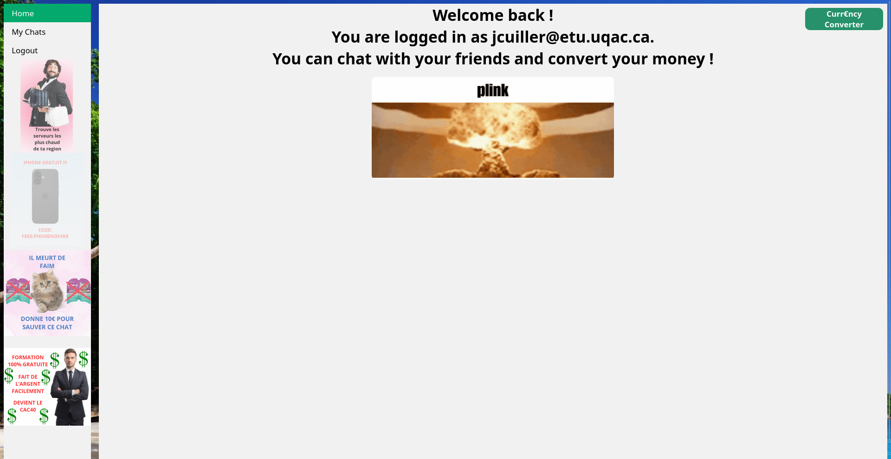
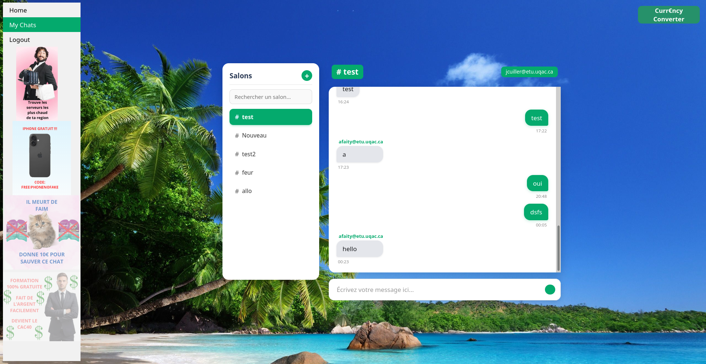

# Projet fil rouge

## Le Projet
**Ce projet s'inscrit dans le cadre du cours de Développement Web à l'Université du Québec à Chicoutimi (UQAC).** 

Dans une équipe de deux ([**Joseph Cuiller**](https://github.com/Lejo54) et [**Arthur Michon**](https://github.com/Arthurmichon)), nous avions comme cahier des charges une application de messagerie avec une page de connexion, de création de compte et de chat.

## Contraintes
<div align="center">
  Nous avions comme contraintes d'utiliser uniquement HTML/CSS/JavaScript vanilla ainsi qu'une base de données Supabase. Le site est hébergé sur Vercel.<br><br>

  [](https://skillicons.dev)

</div>

## Utilisation
### En ligne
  Cliquez sur ce [**lien**](https://filrouge-messagerie.vercel.app/) qui mène au site web hébergé sur Vercel.
### Local
- Téléchargement
  - Vous pouvez télécharger le dossier en zip, puis le dézipper dans le dossier souhaité.
  - Ou alors, copiez cette ligne dans le répertoire de votre choix : 
    ```sh
    git clone git@github.com:Lejo54/fil_rouge.git
    ```
- Ensuite, pour démarrer le projet, lancez le fichier ```index.html``` avec votre navigateur.

### Après le lancement
- Créez-vous un compte, puis connectez-vous.
  - L'email doit être au format : première lettre du prénom, nom de famille, « @ », puis « etu.uqac.ca ». Exemple : si je m'appelle Luc MICHON, je mets donc : lmichon@etu.uqac.ca
- Entrez un mot de passe.
- Dès que vous êtes connecté, vous pourrez accéder au chat et aux diverses fonctionnalités !

## Screenshots de l'application

<div align="center">

### Page d'accueil


### Page de chat


</div>

## Description technique
### Arborescence

- 📁 chat
  - 🌐 chat.html
  - ⚙️ chat.js
- 📁 connection
  - ⚙️ connection.js
  - 🌐 signin.html
- 📁 creation_account
  - ⚙️ creation.js
  - 🌐 signup.html
- 📁 css
  - 🎨 base.css
  - 🎨 chat.css
  - 🎨 converter.css
  - 🎨 form.css
- 📁 currency_converter
  - ⚙️ currency_converter.js
- 📁 images
  - 📸 background.jpg
  - 📸 chat.png
  - 📸 home.png
  - 📸 logo.png
  - 📸 pub1.png
  - 📸 pub2.png
  - 📸 pub3.png
  - 📸 pub4.png
- 📁 utils
  - ⚙️ auth.js
  - ⚙️ data.js
  - ⚙️ env.js
  - ⚙️ home.js
  - ⚙️ pub.js
  - ⚙️ supabaseClient.js
- 🌐 index.html

### Fonctionnalités
#### Index
- Utilisateur
  - ([**index.html**](./messagerie/index.html)) : La page index permet de se connecter, de créer un compte et d'utiliser le convertisseur de monnaie.
- Fonctionnement
  - La page affiche un message pour inviter l'utilisateur à se connecter s'il ne l'est pas. Sinon, un message indiquant l'utilisateur connecté s'affiche, ainsi qu'un chat qui explose grâce à un script JavaScript ([**home.js**](./messagerie/utils/home.js)).

#### Connexion
- Utilisateur
  - ([**signin.html**](./messagerie/connection/signin.html)) : La page de connexion permet de se connecter avec un email et un mot de passe ou d'accéder à la page de création de compte.
- Fonctionnement
  - Quand l'utilisateur clique sur submit, un script JavaScript ([**connection.js**](./messagerie/connection/connection.js)) récupère les informations, vérifie leur conformité, puis appelle la base de données Supabase pour connecter l'utilisateur si un compte existe. Sinon, cela renvoie une erreur adaptée pour l'utilisateur.

#### Création de compte
- Utilisateur
  - ([**signup.html**](./messagerie/creation_account/signup.html)) : La page de création de compte permet de créer un compte avec un email uqac.ca ainsi qu'un mot de passe que l'on doit confirmer en le retapant dans l'encadré prévu.
- Fonctionnement
  - Quand l'utilisateur clique sur submit, un script JavaScript ([**creation.js**](./messagerie/creation_account/creation.js)) récupère les informations, vérifie leur conformité, puis appelle la base de données Supabase pour créer un compte à l'utilisateur. Si un compte existe ou qu'une information n'est pas dans le bon format, cela renvoie une erreur adaptée pour l'utilisateur.

#### Chat
- Utilisateur
  - ([**chat.html**](./messagerie/chat/chat.html)) : Vous pouvez créer un nouveau channel de message ainsi qu'accéder aux autres channels créés par vous ou par les autres utilisateurs.
- Fonctionnement
  - En fonction des actions de l'utilisateur (création de salon, envoi de message, sélection d'un salon), un script JavaScript ([**chat.js**](./messagerie/chat/chat.js)) fait un appel à la base de données Supabase pour récupérer les informations adaptées.
  
#### Convertisseur de monnaie
- Utilisateur
  - Il est accessible en tout temps sur les pages home et chat, utilisateur connecté ou non. Vous pouvez choisir une monnaie de départ, un montant et une monnaie finale. Il suffit de cliquer sur convert pour convertir le montant, qui s'affichera dans l'encadré prévu à cet effet.
- Fonctionnement
  - Lors du premier chargement de la page index ou chat, un script JavaScript ([**currency_converter.js**](./messagerie/currency_converter/currency_converter.js)) charge les différentes monnaies dans les select box en faisant un appel à l'API [**Exchange Rate API**](https://www.exchangerate-api.com/), qui fournit ces monnaies. Ensuite, quand l'utilisateur clique sur le bouton submit, un autre appel est fait en donnant la monnaie de base, la monnaie à convertir et le montant, renvoyant le montant converti.

#### Déconnexion
- Utilisateur
  - Quand on clique sur le bouton signout, l'utilisateur se retrouve sur la page de connexion et ne peut plus accéder au chat.
- Fonctionnement
  - Le bouton appelle une fonction dans un script JavaScript ([**home.js**](./messagerie/utils/home.js)) qui appelle la base Supabase pour déconnecter l'utilisateur, nettoyer la session et le renvoyer vers la page de connexion.